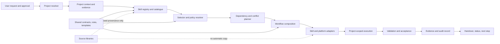

# Proposed Architecture

**Status:** Proposed; not approved or implemented.

## Purpose and constraints

Project-Universal-Global-AI-Skills is a repository-first, modular ecosystem for discovering, selecting, and composing reusable AI-agent skills across projects. The first release should be a static, version-controlled catalogue, schema, policies, and validation suite—not a web application, database, or autonomous agent service.

Constraints:

- Preserve the source libraries as read-only inputs until the owner reviews and approves specific migrations.
- Keep project code and project evidence isolated from globally reusable skills.
- Treat the earlier 443-resource/143-skill inventory as a snapshot, not completeness or quality certification.
- Do not create 80 placeholder skills. Candidate IDs are traceability references; many map better to workflows, shared contracts, templates, or future capabilities.
- Keep tool permission, build/test approval, production release, privacy, and project-level policy boundaries explicit.
- Do not install dependencies or introduce a runtime application until an approved requirement justifies one.

## Architecture view

The initial implementation is the static portion: registry schema, catalogue records, lifecycle workflows, rule/template references, and a validator. Project resolver, orchestration, integrations, dashboard, and persistence are later-phase capabilities and must not be implied by this diagram.

## Responsibility boundaries

| Component | Owns | Does not own |
|---|---|---|
| Canonical skill registry | Stable skill ID, version/status, source provenance, lifecycle group, triggers, inputs/outputs, dependencies, permissions, and validation criteria | Project-specific runtime state or executable authorization |
| Catalogue/search | Human-readable filters, candidate crosswalks, tags, and source links generated from registry metadata | Claiming capability completeness based on title/description |
| Skill contract | Consistent authoring and evidence expectations for one independently triggerable capability | Multi-stage orchestration or project data storage |
| Workflow library | Ordered handoffs composing existing skills, shared rules, templates, and gates | Duplicating the full contents of constituent skills |
| Shared rules/contracts | Reusable cross-skill policy, evidence, approval, status, and data boundaries | Silently overriding local mandatory rules |
| Orchestration policy | Select minimal skill set, order dependencies, identify conflicts, request approval, and recover from failures | Executing tools without platform and user authorization |
| Project workspace | Isolated project pointers, context, evidence, decisions, status, and outputs | Mixing project code/secrets into global skill definitions |
| Validation | Schema, uniqueness, dependency, reference, coverage, and scenario checks | Treating static checks as runtime or platform verification |
| Integrations | Explicit, least-privilege adapters for MCP, agent platforms, or automation | Implicit credentials, unbounded actions, or policy bypass |

## Canonical registry

`schemas/skill-registry.schema.json` proposes a versioned JSON Schema for registry entries. A future registry instance should be generated or validated from this schema and contain no secrets.

Each skill record must include:

- Stable unique kebab-case ID and human-readable name.
- SemVer version, contract version, lifecycle status, and one primary lifecycle group.
- Purpose and positive/negative trigger conditions.
- Provenance: source repository/path, content hash where available, review state, and license/ownership status when known.
- Dependencies with required/optional status and version range.
- Typed inputs and outputs, including requiredness and sensitivity.
- Tool requirements and permission class; state external side effects and explicit approval boundary.
- Measurable validation criteria and evidence state.
- Candidate IDs 01–80 related to this capability. Candidate mapping is many-to-many; a candidate need not have a dedicated skill.

Schema validation checks entry shape. A future validator must separately enforce unique IDs, valid cross-references, acyclic required dependencies, existing provenance paths, and catalogue/candidate completeness; JSON Schema alone cannot guarantee cross-record uniqueness or source reachability.

### Skill lifecycle status

`proposed -> authored -> statically_validated -> scenario_tested -> platform_verified`

Any active state can transition to `deprecated` through an approved compatibility/deprecation record. A skill may not skip validation states in catalogue reporting. Failed checks remain visible with evidence; they do not downgrade into a success-shaped fallback.

## Lifecycle groups and capability form

The primary groups are discovery, research, requirements, planning, architecture, development, integration, testing, security, documentation, deployment, release, maintenance, and continuous improvement. The complete candidate-by-candidate allocation and proposed form—standalone skill, shared component/rule, workflow, template/report, integration adapter, or deferred new skill—is in [LIFECYCLE_MAP.md](./LIFECYCLE_MAP.md).

Existing skills are reused by reference first. The initial candidate for genuinely new standalone work is limited to problem discovery (16) and technical research (17), and only after their scope and validation scenarios are approved. Other gaps are initially addressed with contracts/workflows or deferred pending evidence. No new standalone skill is authorized by this proposal.

## Project isolation and data boundaries

Each project workspace is keyed by a stable project ID and keeps separate:

- `context/`: repository identity, instructions, architecture facts, and freshness dates.
- `evidence/`: source citations, test outcomes, approvals, findings, and limitations.
- `decisions/`: approved choices, denied actions, and unresolved questions.
- `status/`: current stage, blockers, verified next actions, and update timestamp.
- `outputs/`: project deliverables; not reusable library content by default.
- `config/`: project-specific non-secret skill policy overrides and tool allowlists.

The workspace should reference the project repository rather than clone it into the global skills repository. Credentials, customer data, raw sensitive logs, and unredacted project artifacts are excluded. Knowledge may be promoted to a global reference only after authorization, redaction, provenance, and ownership review.

## Skill selection and orchestration

For each task:

1. Resolve the requested project and scope; stop if identity or access is ambiguous.
2. Load local instructions plus global safety rules; surface conflicts and apply explicit authority/precedence rather than silently overriding.
3. Use task intent, positive/negative triggers, lifecycle stage, required outputs, and candidate links to identify skill candidates.
4. Select the smallest set meeting the task; require a concrete dependency/handoff reason before including a prerequisite.
5. Topologically order required dependencies, reject cycles, and identify file/resource ownership conflicts before parallel work.
6. Classify planned actions as read-only, file-modifying, code-executing, external/costed, data-changing, or production-impacting. Request scoped approval for gated actions.
7. Execute with a checkpoint per meaningful handoff. Record inputs, outputs, errors, approvals, changed paths, and verification state.
8. Validate each output against skill acceptance criteria; preserve failed/unverified states and avoid retrying side effects without fresh authorization.
9. Produce project-scoped evidence, status, blockers, and next-step handover.

Conflict handling prioritizes explicit user intent and safety, then applicable project policy, then shared policy, then skill recommendations. A lower-level skill cannot relax a higher-level permission boundary. When two skills claim exclusive ownership of the same output, prefer one owner and a review handoff over concurrent editing.

Failure recovery stops dependent steps, captures the actual failure, preserves partial outputs, and resumes only from a verified checkpoint. Retry policy is action-specific; non-idempotent operations are never replayed automatically.

## Validation and reporting

The planned validation system is static-first:

- **Registry:** schema validity, required fields, SemVer, status transitions, unique IDs, provenance, and allowed candidate ID range.
- **Dependencies:** resolvable IDs, version constraints, cycles, and ordering.
- **References:** local links and source paths, stale paths, and optional hash drift.
- **Catalogue:** every registered skill discoverable; every candidate 01–80 has an explicit mapping and disposition.
- **Duplicates/overlap:** exact hash groups plus reviewable semantic overlap candidates; automated similarity is a signal only, never automatic deletion/merge.
- **Workflows:** required stage coverage, reachable branches, required approval/failure/recovery paths, and output contracts.
- **Scenarios:** safe, deterministic tests for trigger/non-trigger selection, dependency ordering, permissions, conflicts, failures, and output shape.
- **Platform:** separate discovery/metadata compatibility checks per supported host.

Reports must distinguish `proposed`, `created`, `implemented`, `statically validated`, `scenario tested`, and `platform verified`. A dashboard begins as generated static reports. A persistent dashboard service is out of scope until there is an approved consumer, data retention model, and access-control design.

## Decisions intentionally deferred

- Database or runtime service for the skill/project registry.
- Search engine, vector store, or cross-project knowledge ingestion.
- Agent autonomy, parallel execution coordinator, and task queue.
- MCP server configuration and production automation.
- Web dashboard, scheduled auditing, telemetry retention, and cost optimization instrumentation.
- Source migration, license consolidation, and deprecation decisions.

These are not needed to establish an auditable, useful first foundation.

