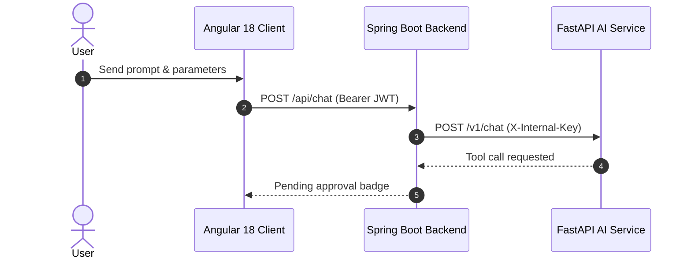

# Skill - 173 - Documentation Engineering

## Purpose and Scope
Author, maintain, synchronize, and validate enterprise-grade technical documentation. Transforms fragmented code knowledge into clear, accessible, and structured markdown documents, including API guides, architecture diagrams, runbooks, mathematical typeset expressions (KaTeX/LaTeX), and interactive developer workflows.

## Trigger Conditions
- Creating or updating project `README.md`, developer guides, or onboarding runbooks.
- Designing API reference documentation and data contracts.
- Visualizing systems using Mermaid flowcharts, sequence diagrams, or class diagrams.
- Typesetting mathematical, physical, or algorithmic equations using LaTeX/KaTeX standards.
- Resolving documentation drift between written guides and codebase reality.

## Non-Trigger Conditions
- Do not trigger for writing unit test code (use `qa-test-automation-strategy`).
- Do not trigger for modifying application logic or refactoring code (use `clean-code-refactoring`).
- Do not trigger for generating user marketing materials or non-technical prose.

## Prerequisites and Inputs
- Verified codebase context, architecture diagrams, or active source files.
- Knowledge of target markdown interpreter capabilities (KaTeX math, Mermaid diagrams, GitHub Flavored Markdown).
- Accurate version numbers, endpoints, and CLI commands.

## Execution Workflow
1. **Audience & Intent Identification**:
   - Classify documentation by audience: Onboarding Engineers, API Consumers, System Administrators, Mathematical Researchers.
2. **Structure & Hierarchy Standardization**:
   - Use standard document sections: Executive Summary, Architecture Overview, Quick Start, Prerequisites, Configuration Reference, Troubleshooting.
3. **Diagrammatic Modeling (Mermaid)**:
   - Create diagrams using supported syntax: `flowchart TD` / `flowchart LR`, `sequenceDiagram`, `stateDiagram-v2`, `classDiagram`.
   - Ensure labels with special characters or parentheses are quoted (e.g. `id["Label (Extra)"]`).
4. **Mathematical Typesetting (KaTeX/LaTeX)**:
   - Use KaTeX conventions: inline math `$...$` or `\(...\)`; block math `$$...$$` or `\[...\]` on its own line.
   - Escape literal dollar signs (`\$`) in text to prevent inadvertent math rendering.
5. **Cross-Link & Anchor Verification**:
   - Use clickable markdown links with `file:///` scheme or relative paths.
   - Ensure all linked files exist on the filesystem.
6. **Drift Scrubbing**:
   - Compare CLI examples against actual tested execution to eliminate phantom commands.

## Commands and Examples
```markdown
# Example Mermaid Sequence Diagram:


# Example KaTeX Mathematical Formulation:
$$\mathcal{L}_{CE} = -\sum_{i=1}^{V} y_i \log(\hat{y}_i), \quad PPL = \exp(\mathcal{L}_{CE})$$
```

## Deliverables and Outputs
- `README.md`: High-impact repository front page with architectural overview and verified setup commands.
- `docs/API.md`: Exhaustive REST endpoint documentation with request/response JSON schemas.
- `docs/ARCHITECTURE.md`: High-level system design with Mermaid flowcharts.
- Verified LaTeX and KaTeX typeset formulations for quantitative algorithms.

## Quality Gates and Acceptance Criteria
- 100% of links in the documentation resolve to active files or valid URLs.
- All code and CLI examples are tested and verified against the actual environment.
- No phantom files or outdated commands referenced.

## Security and Safety Rules
- Never expose plaintext credentials, tokens, internal IP addresses, or private infrastructure details in documentation.
- Redact secrets with placeholders like `${API_KEY}` or `<your-secret-here>`.
